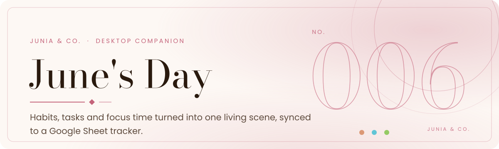
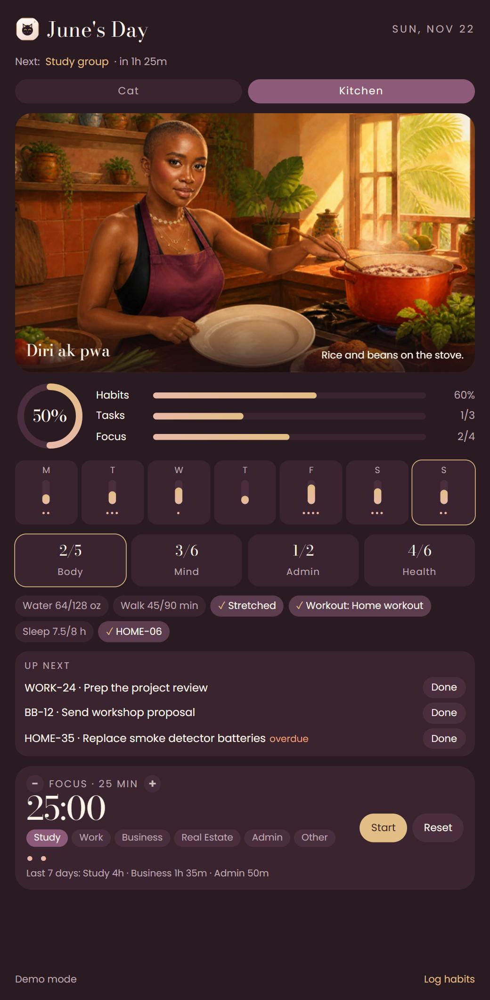
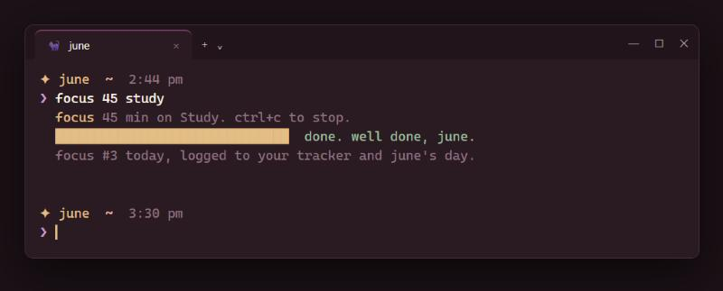
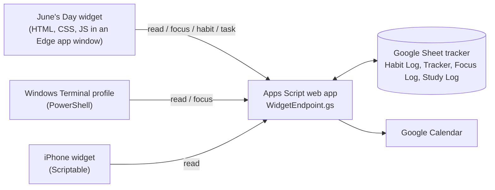

<div align="center">

<picture>
  <source media="(prefers-color-scheme: dark)" srcset=".github/brand/banner-dark.svg">
  
</picture>


<br>

</div>

A cozy desktop companion that turns a day of habits, tasks and focus time into one living scene. A black cat settles down, or a Haitian dinner comes together on the stove, as the day's progress fills in. Everything syncs to a Google Sheet tracker, so the laptop, the terminal and the phone all tell the same story.

<p align="center">
  
  &nbsp;&nbsp;
  
</p>

> Designed, product-managed and shipped by **Junia Janvier**, built in partnership with Claude (Anthropic) as an AI pair builder.

<p align="center"></p>

## Why it exists

Most habit apps ask for a lot of tapping and give back a streak number. This project started from a different question: what if progress felt like a mood instead of a score? The day's work drives a small story. Skip everything and the cat knocks the tea over. Hit your habits, tasks and focus goals and she purrs on the desk while the candle burns low.

The second goal was a single source of truth. Tasks, habits and study time already lived in a Google Sheet tracker. June's Day reads from that sheet and writes back to it, so there is no second app to keep in sync.

<p align="center"></p>

## What it does

- **Daily score, shown as a scene.** Habits (50%), tracker tasks finished today (30%) and focus sessions (20%) blend into one score that picks one of four illustrated moods, with live canvas smoke, steam, candle glow and floating hearts layered on top.
- **Two worlds.** A cat in a library at dusk, or a kitchen where *diri ak pwa*, *griyo* and *bannann peze* come together as the day goes well.
- **Tap to log habits.** Water adds 16 oz per tap, walks add 15 minutes, pages add 5. Yes/no habits toggle. Changes land straight in the sheet.
- **Up next.** The top three tasks due today or overdue, each with a Done button. Recurring tasks stay open and get a dated note instead, so standing commitments never disappear.
- **Focus timer with topics.** Choose Study, Work, Business, Real Estate, Admin or Other (easy to rename). Focus and break lengths adjust with − / +, and every fourth session earns a long break. The last seven days of minutes show by topic.
- **Week at a glance.** Seven small meters for daily habit scores, with dots for focus sessions.
- **Next event.** A countdown to the next calendar event.
- **Gentle nudges.** After each session, a quick prompt to drink water or stretch, with one tap to log it. It skips whatever is already done.
- **Terminal and phone.** A themed Windows Terminal profile runs `focus 45 study` and `today`, and a Scriptable widget shows the same progress on the iPhone home screen.

<p align="center"></p>

## The terminal side

A themed Windows Terminal tab greets the day with a cat, the date and a rotating quote from Black and Haitian writers (Kreyòl proverbs come with an English line). `today` pulls the same habits, tasks, focus and next event from the tracker, and `focus 45 study` runs a timer that logs straight to the Focus Log when it finishes.

<p align="center">
  
</p>
<p align="center">
  
</p>

<p align="center"></p>

## How it works



- **One endpoint, one key.** A Google Apps Script web app answers every request. Reads return today's Habit Log row, habit targets, tasks, focus totals, the last seven days and the next event. Writes are limited to three actions: log a focus session, update a habit, mark a task done. Every call must carry a secret key.
- **Offline first.** A finished focus session gets a unique ID and waits in a local queue until the tracker confirms it. The server ignores an ID it has already logged, so retries never double count. Sessions from the terminal fall back to a local file that the widget syncs later.
- **No build step.** The widget is a single HTML file with inline CSS and JavaScript, local fonts and art. It runs as a frameless Microsoft Edge app window that starts with Windows.

<p align="center"></p>

## Product decisions worth noting

| Decision | Why |
| --- | --- |
| The sheet stays the source of truth | The tracker already powered dashboards, a Gantt view and capacity planning. A second database would split the truth. |
| Writes are narrow and key-gated | The endpoint can only touch today's habit row, a task's status and the Focus Log. Nothing else in the sheet is writable from outside. |
| Session IDs make writes idempotent | Laptops sleep and Wi-Fi drops. Retrying the same session is always safe. |
| Recurring tasks never close | Marking a weekly commitment Done would erase it from capacity planning, so the widget logs the instance in Notes instead. |
| Time zones handled at the sheet | The sheet runs on Pacific time and the script on Eastern. Dates are parsed in the sheet's own zone so a late-evening session never lands on yesterday. |
| Mood over metrics | A score still exists, but the scene carries the feedback. Encouragement lands better than a red number. |

<p align="center"></p>

## Try it

The widget ships with a demo mode that runs on sample data, with no tracker needed.

1. Copy `widget/config.example.js` to `widget/config.js` (it starts with `demo: true`).
2. Serve the `widget` folder with any static server, for example `npx serve widget`, then open the page.
3. Switch between Cat and Kitchen, tap habits, mark tasks done and run a short focus session.

To connect a real tracker, follow [docs/SETUP.md](docs/SETUP.md).

<p align="center"></p>

## Project structure

```
widget/            the desktop widget (index.html, art, fonts, sample data, example config)
apps-script/       WidgetEndpoint.gs, the Google Apps Script web app
terminal/          june-profile.ps1, the Windows Terminal profile
iphone/            junes-day-widget.js for the Scriptable app
docs/              setup guide and screenshots
```

<p align="center"></p>

## Tech

HTML, CSS and vanilla JavaScript (Canvas 2D for particles, Web Audio for the chime), Google Apps Script with SpreadsheetApp, CalendarApp and LockService, PowerShell 5.1, Scriptable for iOS, and Microsoft Edge app mode on Windows 11.

<p align="center"></p>

## Credits and license

- Code: MIT License (see [LICENSE](LICENSE)).
- Illustrations and the cat icon: © Junia Janvier, all rights reserved. Please do not reuse them; bring your own art if you fork the project.
- Fonts: Bodoni Moda and Poppins, both under the SIL Open Font License.
- Haitian proverbs in the terminal quotes are traditional.

<p align="center"></p>

<p align="center">
  <a href="https://juniajanvier.com"></a>
</p>
